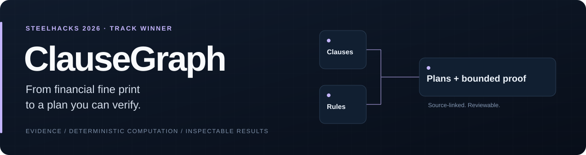
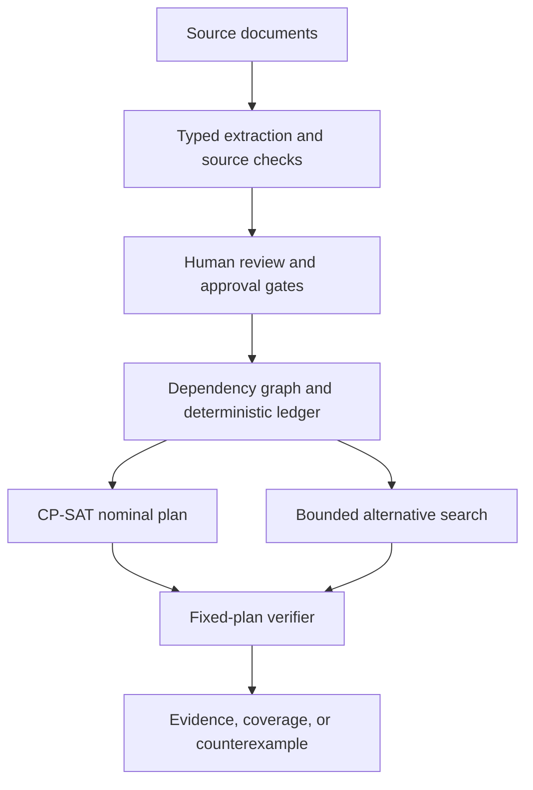

<p align="center">
  <strong>1st Place · DigitalOcean &amp; XTRACT Track · SteelHacks 2026</strong><br>
  Contract formalization, dependency analysis, and verifiable financial planning.
</p>

<p align="center">
  <a href="#quick-start">Run locally</a> ·
  <a href="#a-concrete-example">See the example</a> ·
  <a href="docs/ARCHITECTURE.md">Architecture</a> ·
  <a href="frontend/demo/presenter-cues.md">Demo walkthrough</a>
</p>

<p align="center">
  
  
  
  
</p>

## The idea

Financial decisions rarely live in one document. A payment extension may solve a short-term cash gap, while cancelling a service may accelerate a separate debt.

**ClauseGraph turns those connections into an inspectable decision system.** It extracts candidate rules from documents, links their dependencies, computes permitted payment schedules, and checks how a saved plan behaves when income dates, amounts, or approvals change. Every consequence points back to its source evidence.

## What it does

| Capability | Engineering behind it |
| --- | --- |
| **Formalize contract clauses** | Typed extraction candidates, exact-source checks, and explicit human review before rules become actionable. |
| **Expose hidden dependencies** | A graph connects source documents, rules, approvals, actions, and financial effects. |
| **Plan under constraints** | OR-Tools CP-SAT selects permitted actions and dates; deterministic Python computes every amount in integer USD cents. |
| **Test a fixed plan** | Bounded verification returns **SAFE**, **UNSAFE** with a counterexample, or **UNKNOWN** when coverage is incomplete. |
| **Explore alternatives** | Nonmutating previews, hypothetical cash-gap diagnostics, and a separate bounded search for a verified fixed schedule. |

## A concrete example

The credential-free demo uses **fictional documents and synthetic financial data**:

| Scenario | Minimum cash | What it demonstrates |
| --- | ---: | --- |
| Original schedule | −$400 | A bill arrives before income. |
| Move an approved $450 installment | $50 | Timing improves; ending cash stays $500. |
| Payday slips to September 27 | −$400 | The fixed-plan verifier finds a specific failure on September 26. |
| Cancel the $60 phone charge | −$820 | The same $480 device debt becomes due earlier. |

The original verification checks **8/8 declared payday dates**. A separate resilient example yields a verified schedule with a **$1 fee**, **$49 minimum cash**, and **SAFE 3/3** coverage. These are reproducible software examples, not customer outcomes or financial performance claims.

## Architecture



| Layer | Stack |
| --- | --- |
| Interface | Next.js, TypeScript, Tailwind CSS, React Flow, Recharts |
| API and contracts | FastAPI, Pydantic, OpenAPI, generated TypeScript types |
| Reasoning | NVIDIA Nemotron extraction; allowlisted rule effects; OR-Tools CP-SAT |
| Persistence | SQLite locally; PostgreSQL support; versioned documents and session history |

Nominal optimization, fixed-plan verification, and alternative search answer different questions. Verification applies only to the declared bounds, model, and horizon; incomplete enumeration never becomes a safety guarantee. The app supports decisions and does not execute payments or other real-world actions.

## My contribution

**Daniel Pan · team project.** My recorded work includes the [bounded cash-gap diagnostic contract](https://github.com/danielpan01/ClauseGraph/commit/b5d9204a62ba854cfd82c1a8bf90ca90b0adf174), [exact-count uncertainty controls](https://github.com/danielpan01/ClauseGraph/commit/2e7653718ff7fac27158789deff965775da408a1), and [cash-gap demo and recovery regression](https://github.com/danielpan01/ClauseGraph/commit/8f6c627e9d825a07630658d6d906e2772690a6b0).

This portfolio fork preserves the collaborative history of [the original ClauseGraph repository](https://github.com/oliverchennn/clausegraph).

## Quick start

Requires **Python 3.12**, **Node.js 22.23.2**, and **npm 10.9.8**. The synthetic demo needs no API keys.

```bash
git clone https://github.com/danielpan01/ClauseGraph.git
cd ClauseGraph
python3.12 -m venv .venv
.venv/bin/python -m pip install -r backend/requirements.txt -c backend/requirements.lock
npm --prefix frontend ci
test -f .env || cp .env.example .env
.venv/bin/python scripts/dev.py
```

Open **[localhost:3000](http://localhost:3000)**. The launcher starts the API, worker, and frontend.

<details>
<summary>Windows PowerShell</summary>

```powershell
git clone https://github.com/danielpan01/ClauseGraph.git
cd ClauseGraph
python -m venv .venv
.\.venv\Scripts\python.exe -m pip install -r backend/requirements.txt -c backend/requirements.lock
npm --prefix frontend ci
if (-not (Test-Path .env)) { Copy-Item .env.example .env }
.\.venv\Scripts\python.exe scripts/dev.py
```

</details>

Reproduce the bounded examples with the virtual environment activated:

```bash
python scripts/verify_demo.py
python scripts/synthesize_demo.py
```

## Verification and further reading

The recorded [CI checkpoint for `9cbe749`](https://github.com/oliverchennn/clausegraph/actions/runs/35520190296) passed **483 backend tests** and **66 browser tests**, alongside lint, generated-contract checks, production build, and clean installs on Linux, Windows, and macOS. These counts describe that historical checkpoint. [Current checks on this fork](https://github.com/danielpan01/ClauseGraph/actions) are reported separately.

| Guide | Focus |
| --- | --- |
| [Verification contract](docs/UNCERTAINTY_CONTRACT.md) | Dimensions, proof semantics, budgets, and limits |
| [Resilient-plan design](docs/RESILIENT_PLAN_SPEC.md) | Candidate search and explicit adoption |
| [Architecture](docs/ARCHITECTURE.md) | Evidence compilation, graph, ledger, and APIs |
| [Provider evidence](docs/SPONSORS.md) | Implemented integrations and recorded live results |
| [Deployment](docs/DEPLOYMENT.md) | Local and optional cloud configuration |

**Project status:** hackathon prototype. The offline demo verifies deterministic application behavior. Successful hosted extraction/OCR and a complete live upload-to-review flow are not established by those tests. External document processing requires explicit consent; credentials remain server-side.
